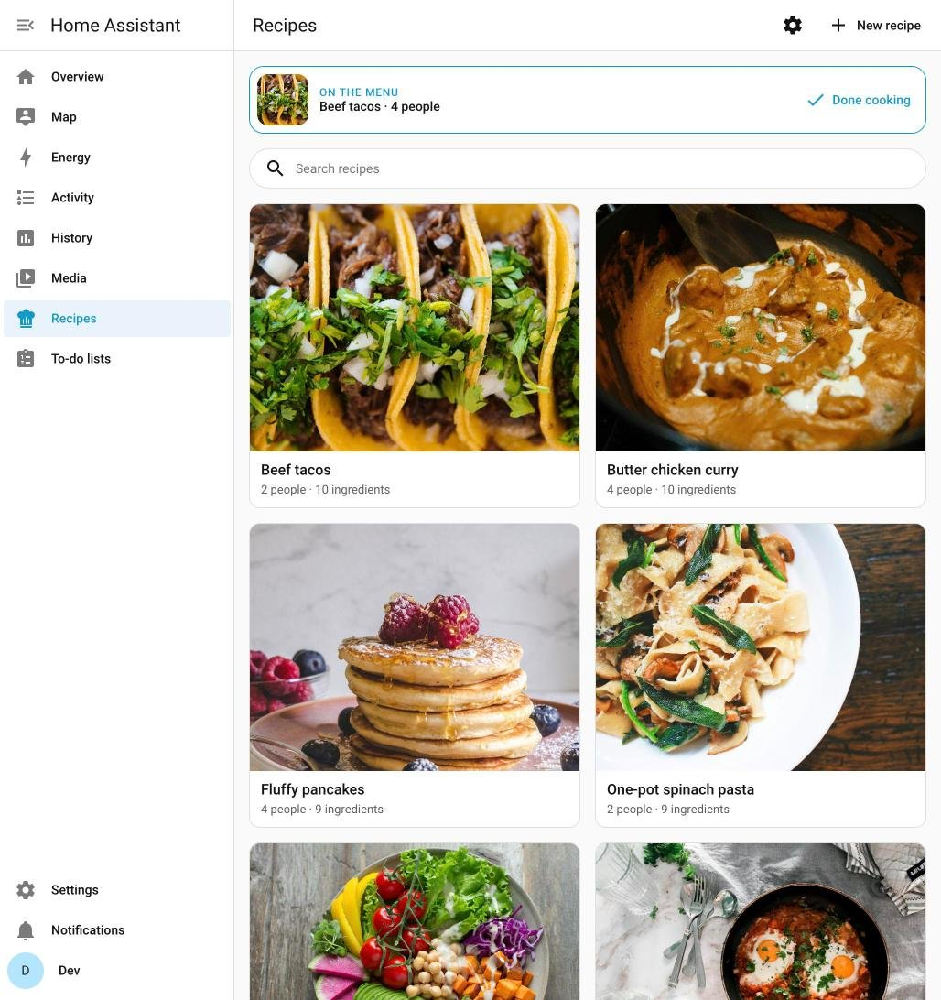
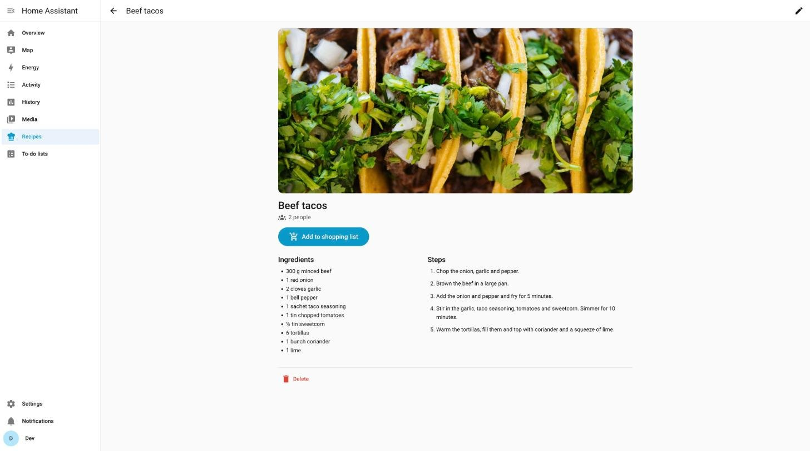
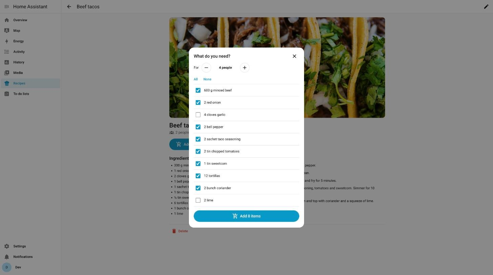
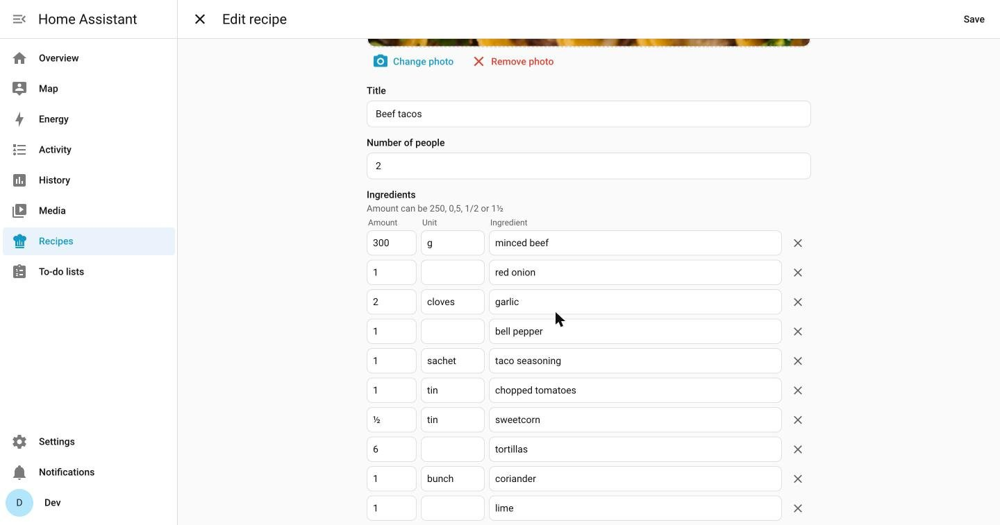
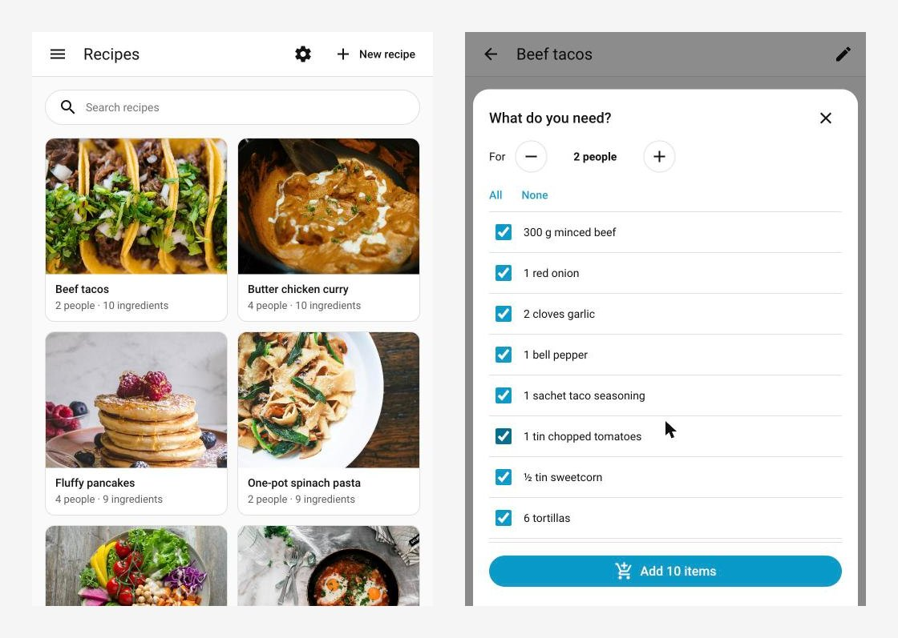
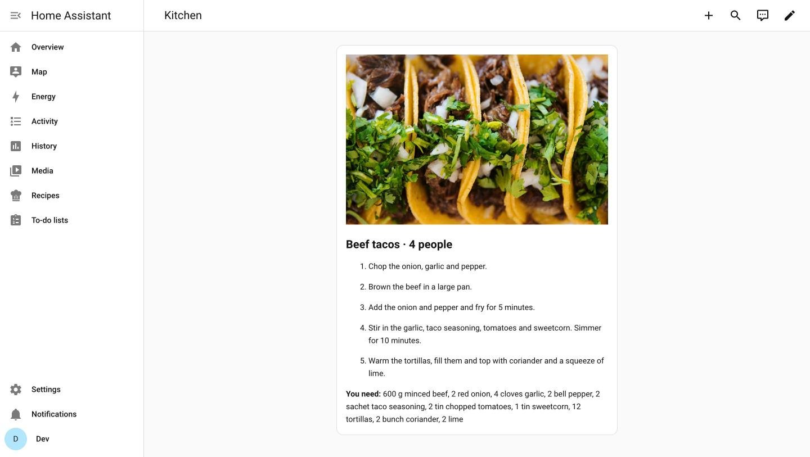

<p align="center">
  
</p>

<h1 align="center">Recipes for Home Assistant</h1>

<p align="center">
  Keep your recipes in Home Assistant and put the ingredients on your shopping list with one tap.<br>
  <a href="https://hacs.xyz"></a>
  
  
</p>



## Features

- **A Recipes tab in the sidebar** with a photo card for every recipe and a search box.
- **Add and edit recipes in the app**: photo (upload or take one with your phone), title, number of people, ingredients (amount · unit · name) and steps.
- **Add to shopping list**: pick the number of people and all amounts scale with it (`½ tin` → `1 tin`), untick what you already have, and the rest goes to your to-do list. Items that are already on the list are skipped.
- **On the menu**: the recipe you add to the list (or mark with *Cook this*) becomes the planned recipe. `sensor.recipes_planned_recipe` has its title, photo, scaled ingredients and steps, so you can show the steps on a kitchen dashboard.
- **How often you made it**: *Done cooking* (or `recipes.clear_plan` with `cooked: true`) counts the recipe as made. Cards show "made 3× · last 12 Oct", and you can sort by most made or longest ago. You can also set the count and date by hand in the editor.
- **Cooking time and favorites**: optional cooking time on every recipe (filter *Quick* for 30 minutes or less). Everyone marks their own favorites with ❤️ and sees who else likes a recipe; filter on *My favorites* or *All favorites*.
- **A shopping list per person**: every Home Assistant user can choose their own to-do list (⚙️ in the tab).
- **Services for automations and AI agents**: `recipes.save`, `recipes.delete`, `recipes.list`, `recipes.add_to_shopping_list`, `recipes.plan`, `recipes.clear_plan` and `recipes.mark_cooked`, also over the REST API. The event `recipes_cooked` fires when a recipe is made.
- **English and Dutch**. The tab follows the language of each user.
- **Local and private**: recipes are stored in `.storage/recipes` and photos in `config/recipes_photos/`. Both are part of your Home Assistant backups.

| Recipe | What do you need? |
|---|---|
|  |  |

| Editor | On your phone |
|---|---|
|  |  |

## Install

**With HACS (recommended)**

1. In Home Assistant open **HACS → ⋮ → Custom repositories**.
2. Add `https://github.com/martijnvanonz/ha-recipes` with type **Integration**.
3. Search for **Recipes**, click **Download** and restart Home Assistant.

**Manually**: copy `custom_components/recipes` into the `custom_components` folder of your configuration and restart.

Then go to **Settings → Devices & services → Add integration → Recipes** and pick the default shopping list (any to-do list, for example the built-in *Shopping list*). The **Recipes** tab appears in the sidebar.

## Services

```yaml
# Create a recipe (no id) or update one (with id; only the fields you give change)
action: recipes.save
data:
  title: Beef tacos
  servings: 2
  ingredients:               # amount is a number and gets scaled; unit is optional
    - {amount: 300, unit: g, name: minced beef}
    - {amount: 1, name: red onion}
    - {amount: ½, unit: tin, name: sweetcorn}
    - {name: salt and pepper}   # no amount
  steps:
    - Brown the beef in a large pan.
    - Warm the tortillas and fill them.
  time_minutes: 25                            # optional cooking time
  favorite: true                              # optional, for the user who calls the action
  photo_url: https://example.com/tacos.jpg   # or photo_base64 (base64 text or data URL)
response_variable: result                    # result.recipe.id

# Put the ingredients on the shopping list
action: recipes.add_to_shopping_list
data:
  title: tacos              # or id; a unique part of the title is enough
  servings: 4               # optional: scale the amounts
  exclude: [garlic]         # optional; or only: [...]
  shopping_list: todo.groceries   # optional; default from the integration settings
  plan: true                # optional (default true): also make it the planned recipe
response_variable: added    # {added: [...], skipped: [...], shopping_list: ...}

# Mark a recipe as planned without touching the shopping list, or clear it
action: recipes.plan
data:
  title: tacos
  servings: 4

action: recipes.clear_plan
data:
  cooked: true              # optional: also count the planned recipe as made

# Count a recipe as made without planning it
action: recipes.mark_cooked
data:
  title: tacos
  date: "2026-10-11"        # optional, default today

# Get all recipes
action: recipes.list
response_variable: recipes

# Delete a recipe and its photo
action: recipes.delete
data:
  id: 0123456789abcdef0123456789abcdef
```

Over the REST API add `?return_response`, for example:

```bash
curl -X POST -H "Authorization: Bearer $TOKEN" -H "Content-Type: application/json" \
  -d '{"title": "tacos", "servings": 4}' \
  "http://homeassistant.local:8123/api/services/recipes/add_to_shopping_list?return_response"
```

### The planned recipe sensor

`sensor.recipes_planned_recipe` shows the title of the planned recipe (`unknown` when nothing is planned). Its picture is the recipe photo, and it has these attributes:

| Attribute | Example |
|---|---|
| `servings` | `4` |
| `ingredients` | `["600 g minced beef", "2 red onion", …]` (scaled to `servings`) |
| `steps` | `["Chop the onion, garlic and pepper.", …]` |
| `recipe_id`, `planned_since` | |

### Ingredients

Every ingredient is stored as `{amount, unit, name}`. Only the **amount** is scaled, and it must be a number: `250`, `0,5`, `0.5`, `½`, `1½`, `1/2`, `1 1/2` or a range like `2-3`. Amounts are stored in a standard form (`0,5` → `½`). The unit is free text and is never guessed.

For convenience `ingredients` also accepts plain text lines (`"1 red onion"`). Then only a number at the start becomes the amount and the rest becomes the name.

## Automation ideas

### Get your shopping list when you arrive at a store

Make a [zone](https://www.home-assistant.io/integrations/zone/) for every supermarket you visit and give it the icon `mdi:cart`. This automation sends the open items to your phone when you enter one of those zones. Tapping the notification opens the list.

```yaml
alias: Shopping list at the store
triggers:
  - trigger: state
    entity_id: person.alex          # your person entity
conditions:
  - condition: template
    value_template: >
      {{ states.zone | selectattr('name', 'eq', trigger.to_state.state)
         | selectattr('attributes.icon', 'eq', 'mdi:cart') | list | count > 0 }}
actions:
  - action: todo.get_items
    target:
      entity_id: todo.shopping_list
    data:
      status: needs_action
    response_variable: list
  - variables:
      items: "{{ list['todo.shopping_list']['items'] | map(attribute='summary') | list }}"
  - condition: template
    value_template: "{{ items | count > 0 }}"
  - action: notify.mobile_app_alex_phone   # your phone
    data:
      title: "🛒 {{ trigger.to_state.state }}"
      message: "{{ items | join(', ') }}"
      data:
        url: /todo?entity_id=todo.shopping_list            # iOS
        clickAction: /todo?entity_id=todo.shopping_list    # Android
```

### Show the steps when you walk into the kitchen

Put this card on the dashboard of a tablet in the kitchen. It appears when someone is in the kitchen and a recipe is planned.

```yaml
type: conditional
conditions:
  - condition: state
    entity: binary_sensor.kitchen_motion       # any motion or presence sensor
    state: "on"
  - condition: state
    entity: sensor.recipes_planned_recipe
    state_not: unknown
card:
  type: markdown
  content: >
    
    

    ## {{ states(r) }} · {{ state_attr(r, 'servings') }} people

    
    {{ loop.index }}. {{ step }}
    

    **You need:** {{ state_attr(r, 'ingredients') | join(', ') }}
```



To clear the menu every night, and count the recipe as made if nobody tapped *Done cooking*:

```yaml
alias: Clear the planned recipe at night
triggers:
  - trigger: time
    at: "03:00:00"
actions:
  - action: recipes.clear_plan
    data:
      cooked: true
```

### Let your AI assistant do it

Give your assistant (for example an LLM agent with access to the Home Assistant API) the services above. Then you can say *"Save this recipe"* with a photo and a list of ingredients, or *"Put tacos for four on the shopping list, but not the garlic"*. That is `recipes.add_to_shopping_list` with `title: tacos`, `servings: 4` and `exclude: [garlic]`.

## Development

```bash
python -m pytest                    # tests
cd dev && docker compose up -d       # local Home Assistant on http://localhost:8124 (dev/ is not in git)
python scripts/make_brand.py         # icon and logo
```

Releases are automatic: raise `version` in `custom_components/recipes/manifest.json` and push to `main`. The release workflow then creates the tag and the GitHub release, and HACS offers the update.

## Credits

Food photos in the screenshots are from [Unsplash](https://unsplash.com) (Unsplash License):
[tacos](https://unsplash.com/photos/z_PfaGzeN9E),
[curry](https://unsplash.com/photos/sqcH2q7lkvo),
[pancakes](https://unsplash.com/photos/MytHEJlzdcM),
[pasta](https://unsplash.com/photos/ddZYOtZUnBk),
[salad](https://unsplash.com/photos/IGfIGP5ONV0),
[shakshuka](https://unsplash.com/photos/KD93b4XevCQ).

## License

[MIT](LICENSE)
